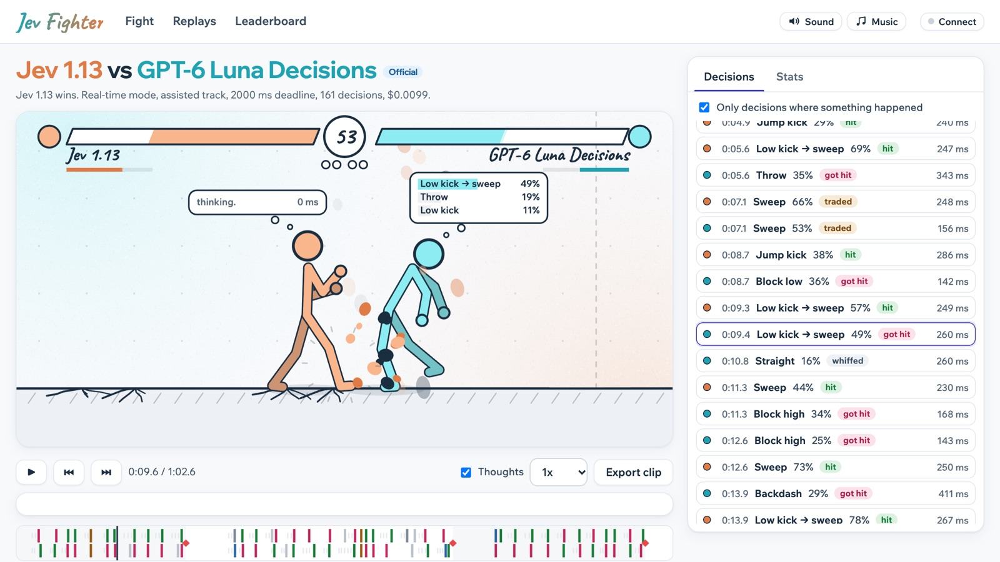

# Jev Fighter

Stick figures fight; models decide. A 2D fighting game where each fighter is controlled by a model,
built as a benchmark: a deterministic engine, exact replays, a log of every decision, stats and an
Elo leaderboard. You can watch matches live, scrub through replays, export clips with sound, and
play against the models yourself.

**Play it at [jev-fighter.apps.sabater.io](https://jev-fighter.apps.sabater.io).**



- **System One decision models** (Jev, Kev, Clef, Laya, Microsoft Decision 1, and GPT-6 Luna through
  OpenAI's Decisions API) are first class. Every decision is one `choice` question whose options are
  the legal moves, and the model's probabilities are kept.
- **Any chat LLM** on [Opper](https://opper.ai) plays the same question, forced into
  `{ move, probabilities }` with a JSON schema.
- **Baselines** (random, always-guard, greedy, payoff, maximin) play through the same harness
  without any model, so every result can be read against them.
- **Your own fighter**: any server that speaks one of three formats. See
  [Build your own fighter](#build-your-own-fighter).

## Run it yourself

You need:

- **Node.js 22.18 or newer** (`node --version`).
- **An Opper API key**, for the listed models. Create one at [platform.opper.ai](https://platform.opper.ai).
  Model calls are billed to it: a classifier match costs $0.001 to $0.02, an LLM match $0.02 to $0.30
  (longer matches cost more). Not needed to play a baseline yourself, to watch two baselines, or to
  use your own endpoints.
- **ffmpeg**, only if you want to regenerate the sounds (`brew install ffmpeg`).

```bash
git clone https://github.com/Jose-Sabater/jev-fighter.git
cd jev-fighter
npm install
cp .env.example .env        # put your key in OPPER_API_KEY (or paste it later under Connect)
npm run dev                 # open http://localhost:5173
```

Then:

1. On **Fight**, pick a fighter for each side and a mode, and press **Fight!** A fighter is a listed
   model, one of your endpoints, a baseline, or you at the keyboard. Baselines need no API key at
   all, which is a free way to see the game. Under **Advanced**
   you can switch to the raw track and change the answer deadline.
   The models are woken up first (hosted classifiers can take up to 30 s after being idle), then the
   match plays live. Every decision appears in the panel on the right.
2. When it ends, the replay is saved. **Watch the replay and stats** opens it.
3. **Replays** lists every saved match; **Leaderboard** ranks the models.

The sound and music buttons in the header turn audio on and off. Browsers only start audio after
you click or press a key on the page.

### Connect: sign-in, keys and your own endpoints

Everything that lets a fighter play is behind **Connect** in the header:

- **Sign in with Opper** (on a hosted copy): every listed model, billed to your Opper wallet.
- **An Opper API key**: the same models, called straight from your browser. **Check** confirms
  the key and shows its project and balance, without spending anything.
- **Your endpoints**: any server speaking one of three formats becomes a fighter in the picker.
  Give it a name, a base URL, a format, a model id and (optionally) a key; **Test** makes one call.

| Format | Path added to the base URL | Example base URL |
|---|---|---|
| System One | `/v1/systemone` | `https://api.opper.ai/v3/compat` (model `typesafe/jev-latest`) |
| OpenAI chat completions | `/chat/completions` | `https://api.opper.ai/v3/compat`, `http://localhost:8000/v1` |
| OpenAI Decisions | `/decisions` | `https://api.opper.ai/v3/compat` (model `gpt-6-luna`) |

An endpoint on Opper with no key of its own uses your Opper key. The endpoint has to allow calls
from a browser (CORS); Opper's API does. Plain `http` only works for `localhost`.

Keys and endpoints stay in your browser. Keys go straight from it to the model's endpoint: never to
this site's server, and never into replays. They are shown masked (`····a3f9`) and are gone when
the tab closes, unless you tick **Remember on this device**. As with any key kept in a browser, a
script running on the page could read it. Each fighter's card says who pays for it, and **Use a
different key** gives one fighter its own.

A fighter uses the first of these that is set: its own key, your Opper key, your Opper sign-in,
`OPPER_API_KEY` from `.env` (on `localhost` only).

### Endpoints in a file: fighters.json

When you run the repo, you can list endpoints in `fighters.json` instead (copy
`fighters.example.json`). They appear in the picker and work in the bench, by their `id`:

```json
{
  "fighters": [
    { "id": "my-bot", "name": "My bot", "url": "http://localhost:8000", "format": "systemone", "model": "my-model" },
    { "id": "luna-decisions", "name": "Luna (Decisions API)", "url": "https://api.opper.ai/v3/compat",
      "format": "decisions", "model": "gpt-6-luna", "keyEnv": "OPPER_API_KEY" }
  ]
}
```

```bash
npm run bench -- --left my-bot --right baseline/greedy --matches 4
```

A key is never written in the file: `keyEnv` names the environment variable (in `.env`) that holds
it. These endpoints are called by the server, so CORS does not matter, and on a hosted copy only
signed-in players can use them.

**What counts on the leaderboard.** Every match played on the site is saved as a **community**
match: anyone can name their endpoint anything, and nobody can check that the moves in a replay
really came from the model it names. Community matches play back like any other and show on the
leaderboard under **Official + community**. **Official** matches come from your own runs (see
[Official matches](#official-matches)). Endpoint fighters are recorded as `custom:<host>/<model>`,
so they never merge with a listed model.

### Build your own fighter

A fighter is a server that answers one question per decision. `examples/fighter-server.mjs` is a
complete one in about 60 lines, with no dependencies. It beats the greedy baseline; make it better:

```bash
node examples/fighter-server.mjs                                    # http://localhost:8000
cp fighters.example.json fighters.json                              # has "my-bot" on that address
npm run bench -- --left my-bot --right baseline/maximin --matches 4
```

or add it in the app under **Connect**, with base URL `http://localhost:8000` and format System One.

Each decision is a `POST` to `<base URL>/v1/systemone`:

```json
{
  "model": "my-model",
  "state": { "you": "212 HP, meter 40, free, 2.1 from your wall", "opponent": "...", "distance": "1.3", "time": "...", "recent": "..." },
  "questions": {
    "move": {
      "type": "choice",
      "instructions": "You control one fighter in a 2D fighting game. ...",
      "criteria": { "jab": "avg +4, worst -12 (if uppercut); adv -3f", "block_low": "...", "throw": "..." }
    }
  }
}
```

Answer with one of the `criteria` keys, and if you can, a probability for each:

```json
{ "answers": { "move": { "choice": "jab", "probabilities": { "jab": 0.6, "block_low": 0.3, "throw": 0.1 } } } }
```

On the raw track each option describes the move itself (`"high, 9 dmg, startup 6f, recovery 14f,
reach 1.1"`) instead of its payoffs. Before a match there is one warm-up question named `warmup`:
answer it the same way. In real time the clock keeps running while you think, so answer fast. If
your server is an LLM behind an OpenAI-style API instead, use the chat completions format: the
question arrives as the prompt, with a `response_format` JSON schema, and the reply is
`{ "choice": "jab", "confidence": 0.6, "others": [{ "move": "throw", "probability": 0.2 }] }`.

### Play it yourself

Pick **You (keyboard)** for one side. A key pressed a moment before your fighter is free still
counts; holding a block or a direction keeps it up. The layout follows Street Fighter 6 and
Tekken 8 on a keyboard: left hand on WASD, punches on U I O, kicks on J K L.

| Key | Move |
|---|---|
| A D (or ← →) | walk; hold back to block high; double-tap: dash / backdash |
| W (or ↑) | jump |
| S (or ↓) | block low (hold) |
| U I O | punches: jab, straight, uppercut (Shift+U: jab, straight) |
| J K L | kicks: low kick, high kick, sweep (Shift+J: low kick, sweep) |
| H | throw |
| Y | jump kick |
| Space | special (when the meter is full) |

In paused mode the fight waits for your key, which makes it a tactical game. Your reaction time is
recorded like a model's latency.

### Replay viewer

| Key | Action |
|---|---|
| Space | Play / pause |
| ← → | One frame back / forward (with Shift: one second) |
| `[` `]` | Previous / next decision |
| `T` | Thought bubbles on / off |

Click a decision card to jump to it and see the full question: the situation, every option with its
facts, and the model's probability for each. The timeline marks every decision, coloured by what
happened, and every KO. Add `?t=<tick>` to a replay URL (60 ticks per second) to link to a moment.

### Exporting clips

In a replay, **Export clip** renders a video: from the current position for 10, 20 or 30 seconds, to
the end, or the whole match. Choose 720p, 1080p or square, 60 or 30 fps, and whether to include sound
effects, music and thought bubbles. Clips are rendered frame by frame in the browser (WebCodecs), so
they are perfectly smooth whatever your machine, usually faster than real time, and saved as MP4
(H.264 + AAC). It needs a recent Chrome, Edge or Safari.

## Benchmarking from the command line

```bash
# Four matches, each pairing played from both sides
npm run bench -- --left typesafe/jev-1.13.0 --right sference/clef --matches 4

# Every pair of these models, two matches each, four at a time
npm run leaderboard -- --models typesafe/jev-1.13.0,sference/clef,gemini/gemini-3.5-flash-lite --matches 2 --parallel 4

# One warm-up and three decisions per model, to check keys and latency
npm run smoke -- typesafe/jev-1.13.0 openai/gpt-5.4-mini
```

| Flag | Default | Meaning |
|---|---|---|
| `--mode` | `paused` | `paused` (the fight waits for answers: decision quality) or `realtime` (thinking costs time) |
| `--track` | `assisted` | `assisted` (options show payoffs) or `raw` (situation and rules only) |
| `--deadline` | 10000 paused, 2000 real time | ms before a missing answer is replaced by the fallback |
| `--matches` | `2` | matches per pairing (alternating sides) |
| `--parallel` | `2` | matches at a time |
| `--seed` | random | the first seed; every pairing plays the same seeds, each from both sides |
| `--upload` | | also save each match on a hosted copy as official (needs `ADMIN_TOKEN`) |

Replays go to `data/replays/`, one summary per match to `data/matches.jsonl`. The web app's
Replays and Leaderboard pages read the same files, so bench matches show up there, as official
matches (unless they use an endpoint from `fighters.json`).

### Official matches

A fair board needs every model to play every other on the same fights, from the same place.
`npm run official` plays the official roster (every model in `shared/models.ts`, plus the maximin,
greedy and random baselines) as a round robin: every pairing gets the same seeds, from both sides.

```bash
# Locally
npm run official -- --mode paused --track raw --matches 4

# And onto a hosted copy, as its official matches
ADMIN_TOKEN=... npm run official -- --mode realtime --matches 4 --upload https://your-site
```

The roster has 16 players, so `--matches 4` is 480 matches: a few dollars of model calls.

### Managing replays

```bash
npm run replays -- list --source community               # here (data/)
npm run replays -- delete <id> <id>                       # here
ADMIN_TOKEN=... npm run replays -- delete <id> --remote https://your-site
```

On the site, admins (see `ADMIN_EMAILS` below, and anyone browsing from the machine the server runs on) get a **Delete** button on
every replay.

Any Opper chat model id works on the command line (it plays through the JSON-schema adapter), and
so do the baselines: `baseline/random`, `baseline/guard`, `baseline/greedy`, `baseline/payoff`,
`baseline/maximin`.
Baseline-only runs need no key and run in seconds. The picker in the web app offers the models listed
in `shared/models.ts`.

### Reading the results

- **Paused is the score.** It measures decisions only. Real time adds speed: a fast classifier gets
  more decisions in and reacts sooner, so it is a separate leaderboard.
- **Ratings are Bradley-Terry** with 95% bootstrap intervals. If two intervals overlap, the order
  between those two is not settled; play more matches (each pairing from both sides).
- **Always compare against the baselines.** `random` picks any offered move; `guard` always blocks;
  `greedy` takes the best payoff if the opponent stands still or repeats itself (it ignores risk);
  `payoff` takes the best average of the assisted payoff row. A model below `random` is not deciding
  anything; one below `payoff` is doing worse than reading its own options.
- **Baselines are not transitive** (maximin beats payoff, payoff beats greedy, and so on), so ratings
  depend on who is in the pool. Compare models in the same pool, and look at the head-to-head matrix.

## The game

Two fighters on a 10 body-length stage. Best of 3 rounds of 60 seconds; a knockout wins a round,
otherwise the fighter with more health when time runs out (equal health is a drawn round, and a match
can run to 5 rounds when rounds are drawn). 100 health each.

**Passivity.** Waiting is not free: a fighter that spends 8 seconds free to act without attacking or
stepping in loses 1 HP per second until it engages (never its last HP). Time spent under attack,
blocking an attack, knocked down or getting up does not count, so defending is never penalized; it only
fires when a fighter refuses to engage. A tag under the fighter's name warns from 6 seconds, and models
see their own and the opponent's passive time in the situation. In tests with the reference bots it
never fired against an opponent that engages, and it ended the always-block strategy's free draws.

A fighter can act when it is standing free, has held a block for 18 frames, or is on its last frame
of getting up (so an attack timed for its wake-up can always be answered). At that moment its model
picks one move. While a model is still thinking, its fighter keeps its guard up (blocks high) and can
still be hit with lows and throws.

### The core rules

- **Strikes beat throws**: a throw misses a fighter who is in the middle of an attack.
- **Throws beat blocks**: throws cannot be blocked. Nobody can be thrown in the 6 frames after getting
  up, being hit or blocking.
- **Blocks beat strikes**: a blocked strike does only a quarter of its damage ("chip").
- **High or low**: block high stops highs and jump kicks; block low stops lows. Guess wrong and you
  are hit.
- **Uppercut beats jump-ins**: it cannot be hit by airborne attacks in its first 8 frames.
- **Jumping and backdashing** dodge lows and throws.

### Moves

Frames are at 60 per second: startup (before it can hit), active (when it can hit), recovery (when
you are stuck afterwards). Reach is the furthest distance between the two fighters' centres at which
it connects, in body-lengths.

| Move | Type | Frames (startup / active / recovery) | Damage | Reach | Notes |
|---|---|---|---|---|---|
| Jab | high | 4 / 2 / 8 | 4 | 1.0 | Fastest move |
| Straight | high | 7 / 3 / 14 | 8 | 1.2 | |
| Low kick | low | 6 / 3 / 12 | 6 | 1.1 | Beats a standing guard |
| High kick | high | 10 / 4 / 20 | 12 | 1.3 | Longest standing reach |
| Uppercut | high | 6 / 4 / 24 | 14 | 0.95 | Knocks down; anti-air: immune to jump-ins for 8 frames |
| Sweep | low | 11 / 4 / 22 | 9 | 1.3 | Knocks down |
| Throw | unblockable | 5 / 2 / 20 | 12 | 0.85 | Knocks down; misses fighters who are attacking or airborne |
| Jump kick | overhead | 34 total, hits frames 14 to 20 | 10 | 1.1 | Travels 1.5 forward; must be blocked high |
| Dash palm (special) | high | 9 / 5 / 26 | 18 | 1.1 | Dashes 1.0 forward first; costs a full meter; absorbs one hit during startup |
| Jab → straight | high | jab, then straight | 4 + 8 | 1.0 | The straight only comes out if the jab hits |
| Low kick → sweep | low | low kick, then sweep | 6 + 9 | 1.1 | The sweep only comes out if the low kick hits |
| Block high | stance | at least 18 | | | Stops highs and jump kicks |
| Block low | stance | at least 18 | | | Stops lows |
| Step in | movement | 12 | | | Moves 0.4 forward |
| Step back | movement | 12 | | | Moves 0.4 back |
| Backdash | movement | 18 | | | Moves 1.0 back, can't be hit for the first 6 frames |
| Jump | movement | 34 | | | Dodges lows and throws, loses to uppercut |

- **On hit**: the defender is stunned for 10 + damage frames. **On block**: 6 + damage / 2 frames,
  and a quarter of the damage.
- **Combos** are guaranteed once the first hit lands (the first hit barely pushes back).
- **Knockdown**: 40 frames down, then 20 frames getting up (can't be hit meanwhile).
- **Hit-stop**: the fight freezes for 3 to 8 frames on every hit, longer for harder hits.
- **Meter** (0 to 100): +1 per point of damage dealt, +0.5 per point taken. The special spends it all.
- Fighters never get closer than 0.7 body-lengths. Attacks that cannot possibly reach are not
  offered unless the opponent is coming in.
- Each match starts at a random distance (2 to 4 body-lengths) and place on the stage, set by its seed.

### What a model is asked

Each decision is one question: the rules and the move table (as instructions), the situation, and
every sensible move. Options are shuffled for every question, so a model that always picks the first
or last option shows up as random. A fighter sees its opponent as it was 10 frames ago (about human
reaction time): a move the opponent started a moment ago is not visible yet.

**Assisted track (default).** Each option has a payoff row computed by the engine, with no verdict:
your HP swing over the exchange if the opponent **stands** (starts nothing new); if it plays its best
answer as soon as it can act (**worst**, with the move named, so a whiffed or blocked attack shows its
punishment); and if it repeats its **usual** attack. **adv** is how many frames you can act before (+)
or after (-) the opponent when the exchange ends. Every move has a risk; the model has to weigh it and
guess what the opponent will do. About 600 to 800 tokens at close range, less further apart.

```
you: 100 HP, meter 0, standing, free to act, 4.0 from your wall
opponent: 100 HP, meter 0, standing, free to act, 4.0 from their wall
distance: 1.1
their usual attack: low_kick

- sweep: stand +9, worst -15 (if low_kick_sweep), usual -6; adv +34f
- low_kick_sweep: stand +15, worst -10 (if jump_kick), usual 0; adv +34f
- jump_kick: stand +2, worst -14 (if uppercut), usual +10; adv -9f
- block_low: stand 0, worst -12 (if high_kick), usual -1; adv -10f
- backdash: stand 0, worst 0, usual 0; adv -19f, ends 2.1
...
```

**Raw track (advanced).** The same situation, but each option is just the move's description
(`sweep: low, 9 dmg, startup 11f, recovery 22f, reach 1.3`). The model has to work out the outcomes
itself. About 500 tokens.

Models with a short context (Laya, 512 tokens) get compact instructions, fewer payoff columns and,
if still needed, only the most promising options.

System One models get the situation as `state` plus one `choice` question; LLMs get it as text and must
answer `{"move": ..., "probabilities": {...}}`. A missing, late, invalid or no-longer-legal answer
makes the fighter block high: the harness never plays well on a model's behalf.

### Real time and paused

- **Real time** (default): the fight never waits. Each model is asked shortly before its fighter is
  free, earlier for models that answer slowly, so a fast model's answer is ready on time and a slow
  one's arrives late. If the situation changes before an answer is used (the fighter gets hit, the
  opponent attacks), the question is asked again, but only if a new answer can still arrive in time;
  otherwise the fighter acts on the older answer. After the deadline the fighter blocks, and the
  decision is marked as a fallback.
- **Paused**: a fighter is asked only when it can act, about the exact current state, and the fight
  waits for every answer, so only the quality of decisions counts. Fighters free at the same moment
  decide simultaneously. Latency is still measured.

## Stats

Per fighter, per match: result, damage dealt and taken, decisions, the outcome of every decision
(hit, traded, blocked, whiffed, got hit, defended; counted from the move until the fighter is free
again, so waiting for the next answer is not blamed on it), latency p50 and p95, answers that arrived
after the fighter was already free and the time spent waiting, cancelled questions, fallbacks, cost and
tokens, and calibration (reliability curve, Brier score and calibration skill).

The leaderboard is per mode and track, over the official matches on the current engine (or official
and community together): Bradley-Terry ratings with bootstrap intervals and a head-to-head matrix. A
player with fewer than 6 matches is marked provisional.

## Sound and music

All sounds and the music track were generated through Opper's audio API (ElevenLabs sound effects and
music models) by `npm run gen-audio`, which writes the raw files to `assets/audio-raw/` and the
trimmed, normalized versions the game uses to `public/audio/`. Change the prompts in
`scripts/gen-audio.ts` and run `npm run gen-audio -- --force` to make new ones. The provider's terms
for generated audio apply.

## Hosting it

On `localhost` the server uses `OPPER_API_KEY` from `.env`. Anywhere else that key is never used:
visitors sign in with Opper, or connect their own API key or endpoints, and live matches are billed
to them; without either they can still watch replays and the leaderboard, play a baseline
themselves, and pit two baselines against each other.

Replays saved from the site are community matches. Saving needs no sign-in, so it is limited: 20 an
hour per address, 400 KB per replay (real ones are 15 to 150 KB), and the newest 20,000 community
matches are kept (about 1 GB). Official matches are never pruned.

The `Dockerfile` builds the page and runs the server on `PORT` (default 3000). Replays and the
match index are written to `/data`: **mount a volume there**, or they are lost with the container.

```bash
docker build -t jev-fighter .
docker run -p 3000:3000 -v jev-fighter-data:/data --env-file .env jev-fighter
```

Variables (all optional):

| Variable | What it is for |
|---|---|
| `OPPER_CLIENT_ID`, `OPPER_CLIENT_SECRET` | Login with Opper: an OAuth app registered at Opper |
| `OPPER_REDIRECT_URI` | `https://<your domain>/auth/callback`, also registered on that OAuth app |
| `SESSION_SECRET` | keeps people signed in across restarts: `openssl rand -hex 32` |
| `ADMIN_TOKEN` | lets scripts upload official matches and delete replays: `openssl rand -hex 32` |
| `ADMIN_EMAILS` | comma-separated: people signed in with these Opper emails can delete replays on the site |
| `PROXY_SECRET` | behind a proxy: only requests with this in an `X-Proxy-Secret` header are served (others are sent to the `OPPER_REDIRECT_URI` site), so the backend's own address cannot skip the proxy |
| `JEV_FIGHTER_MAX_COMMUNITY` | community replays kept (default 20000) |
| `JEV_FIGHTER_DATA_DIR` | where replays go (the image sets `/data`) |

**On Railway:** deploy the repository (it finds the `Dockerfile`), add a volume to the service
mounted at `/data`, set the health check path to `/api/health`, and set the variables above. The
volume survives deploys and restarts; it is only lost if the volume itself is deleted. A service
with a volume runs one instance, so a deploy has a few seconds of downtime.

Without Docker: `npm run build`, then `npm start`.

## License

MIT, see [LICENSE](LICENSE). The sounds and music were generated with ElevenLabs models through
Opper (see [Sound and music](#sound-and-music)).

## Development

```bash
npm test             # engine rules, match driver with fake models, replay determinism, stats
npm run typecheck
```

The pose sheet at `/poses` shows every attack's windup and strike pose, for tuning the animation.

```
shared/engine   deterministic simulation and move data (integer math, 60 ticks per second)
shared/         questions, match driver, replays, stats, greedy fallback
adapters/       System One and chat adapters (used by the server and the CLI)
server/         API, Login with Opper, replay storage
src/            renderer (skeleton, springs, ragdoll, ink effects), audio, clip export, web app
scripts/        bench, smoke, gen-audio
docs/           design spec and plan
```

A replay is the seed plus the decision log (the tick each move was applied) and a state hash every 10
seconds. Playing the log back reproduces the match frame for frame, and the viewer reports it if a hash
does not match. Any change to moves or rules bumps `ENGINE_VERSION`.
